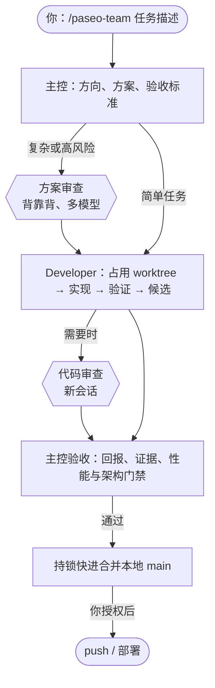

# Paseo Team

**让强模型做决策，让 Developer 干重活，让异构审查兜底。**

一个 [Paseo](https://paseo.sh) Agent Skill：你选的主控负责方向、架构与验收，配置的 Developer 负责排查、实现、测试和部署，复杂任务自动加入方案与代码的对抗性审查。

[](https://github.com/jiffies/paseo-team/actions/workflows/ci.yml)


[快速开始](#快速开始) · [工作原理](#工作原理) · [配置](#配置组合) · [审查机制](#审查机制) · [安全](#安全与权限) · [开发](#开发)

---

## 为什么需要它

单个 agent 干大任务时，常见三个问题：

- **上下文被重活撑爆**：读日志、跑测试、写代码都塞进同一个会话，频繁压缩、丢失细节，决策质量随之下降。
- **长任务把人卡住**：跑几小时测试或实盘时，会话被占用，你没法同时讨论方案。
- **自己审自己**：同一个模型很难发现自己的盲点。

Paseo Team 把这些拆开：

| 角色          | 由谁担任                                    | 只做什么                                                 |
| ------------- | ------------------------------------------- | -------------------------------------------------------- |
| **主控**      | 你在 Paseo 新建 agent 时选的 Profile        | 方向、架构、方案、关键决策、审查裁决、验收；不写业务代码 |
| **Developer** | 所选组合的 `developer`                      | 排查、定位根因、实现、测试、修复；获授权后 push 和部署   |
| **审查者**    | 所选组合的 `planReviewers`、`codeReviewers` | 独立、只读地评估方案或候选，阻断意见必须有位置和出错场景 |

> 一次为期 4 天的真实任务中，两个 Codex Developer 处理了约 17 亿输入 token、7000 多次工具调用；Claude 主控只消耗了其中约十分之一的量，同时一直保持可对话。

## 特性

- 🧭 **角色分离**：主控只做读入少、判断价值高的事，重活整件交给 Developer 一次做完。
- 🔀 **异构审查**：审查者与 Developer 可用不同模型；首轮背靠背，靠证据裁决，轮数有限。
- 🚦 **合并门禁**：没有性能对比、出现性能退化或没说明架构影响的候选，不合并。
- 🧯 **审查熔断**：修了又冒出新阻断时自动停下，交给你决定是继续修还是重写方案。
- 🌲 **Worktree 复用与加锁**：多任务并行互不干扰，复用编译缓存，持锁快进合并本地 main。
- 🧩 **复用官方能力**：派发、咨询、委员会分别用官方 `paseo-handoff`、`paseo-advisor`、`paseo-committee`，本 Skill 只补它们没有的部分。
- 🔐 **凭据隔离**：子 agent 简报强制附带安全规则，检查脚本默认隔离 dotenv。

## 工作原理



1. 主控读取配置，确定本任务成员，写下方向、方案和验收标准；复杂或高风险问题由主控亲自定根因。
2. 需要时，在实现前进行方案审查。
3. 主控通过 `paseo-handoff` 派发 Developer，简报包含任务目录、安全规则和授权范围。
4. Developer 在后台一次做完，最后回报结论、证据、检查结果、性能对比和架构影响。
5. 需要时进行代码审查，然后主控验收并合并；push 和部署只在你明确授权后执行。

## 快速开始

### 前置条件

- Node.js 22+、Git
- 正在运行的 [Paseo](https://paseo.sh) 和[官方 Paseo Skills](https://paseo.sh/docs/skills)
- 合并需要 Linux 或 WSL 的 `flock`

### 安装

```bash
npx skills add jiffies/paseo-team --skill paseo-team -a claude-code codex -g
```

从本地源码安装：

```bash
npx skills add . --skill paseo-team -a claude-code codex -g
```

> [!IMPORTANT]
> 要安装整个 `skills/paseo-team/` 目录，不能只复制 `SKILL.md`；脚本和 references 都是运行时依赖。

在 Paseo 中打开 **Settings → 主机 → Agents → Enable Paseo tools**。在独立的 Claude Code 或 Codex CLI 中使用时，需要各自接入 Paseo MCP（端口以实际为准）：

```bash
codex mcp add paseo --url http://127.0.0.1:6768/mcp/agents
claude mcp add --transport http --scope user paseo http://127.0.0.1:6768/mcp/agents
```

### 首次设置

1. 在 Paseo 中准备 Profiles：一个给主控（例如 Claude Opus high），一个给 Developer（例如 Codex），一到两个给审查者。
2. 新建任意 agent，执行 `/paseo-team setup`，按提示创建一个组合并设为全局默认。
3. 主控是 Claude 且使用 auto mode 时，按 setup 的提示放行[项目权限](#项目权限)，每个项目只需一次。

### 第一个任务

在项目的 workspace 中用主控 Profile 新建 agent，然后：

```text
/paseo-team 给列表增加空状态提示
```

Developer 在后台实现和验证，你不用盯着。完成后主控汇报做了什么、检查结果、候选 commit 和剩余问题。需要修改时直接说“修复……”“继续”，会沿用原来的成员和会话。

## 用法

只有 3 个命令（在 Codex 中把 `/` 换成 `$`），其余都用自然语言：

| 命令                     | 作用                                 |
| ------------------------ | ------------------------------------ |
| `/paseo-team setup`      | 管理组合，设置全局或项目的默认组合   |
| `/paseo-team status`     | 查看所有组合和当前项目实际生效的组合 |
| `/paseo-team <任务描述>` | 开始一个任务                         |

```text
/paseo-team 重构结算流程，需要审查
/paseo-team 修复这个拼写错误，不要审查
/paseo-team 让 pi-deepseek 开发，QA 和 Architect 审查代码
/paseo-team 用省钱组合，给设置页加导出按钮
/paseo-team 只交付候选，不要合并
```

- **多任务并行**：每个任务各开一个主控 agent，同一项目或不同项目都可以。每个任务有独立的任务目录和成员记录，只按记录中的 agent ID 联系自己的 agent。
- **新的无关任务**：新开一个主控 agent。
- **升级 Skill**：等进行中的任务结束后重新执行安装命令，新开的主控使用新版。

## 配置组合

一个**组合**包含三个角色，按 Paseo Profile 名称保存在 `~/.config/paseo-team/config.json`：

```json
{
  "schemaVersion": 3,
  "teams": {
    "标准": {
      "developer": "Developer",
      "planReviewers": ["QA", "pi-deepseek"],
      "codeReviewers": ["QA", "pi-deepseek"]
    },
    "省钱": {
      "developer": "pi-deepseek",
      "planReviewers": ["QA"],
      "codeReviewers": ["QA"]
    }
  },
  "default": "标准",
  "projects": { "/home/me/repo-a": "省钱" }
}
```

所有配置都可以在对话中完成，不用手改文件：

| 你说                                       | 效果                       |
| ------------------------------------------ | -------------------------- |
| “新建组合 省钱：pi-deepseek 开发，QA 审查” | 新建组合                   |
| “这个项目默认用省钱” / “全局默认用标准”    | 设置默认组合               |
| `/paseo-team 用省钱组合，修复 X`           | 本任务使用指定组合         |
| `/paseo-team 让 pi-deepseek 开发，修复 X`  | 本任务临时点名，不写入配置 |

**选用顺序**：任务里点名的 Profile > 任务里指定的组合 > 项目默认 > 全局默认。项目按主仓库路径识别，同一项目的所有 worktree 共用一个默认组合。

> [!TIP]
> 审查者尽量选与 Developer 不同的模型，同源模型容易犯同样的错误。

## 审查机制

| 何时开启                                         | 审查哪些阶段                                           |
| ------------------------------------------------ | ------------------------------------------------------ |
| 你明确要求，或主控判断任务复杂、高风险时自动开启 | 只说“需要审查”：简单任务审代码，复杂任务方案和代码都审 |
| 简单任务或你说“不要审查”时不开                   | 也可以指定“只审方案”“两个阶段都审”                     |

审查规则的设计目标是避免多轮辩论中常见的过早收敛：

- **背靠背**：首轮不透露主控倾向和其他审查者的意见。
- **证据裁决**：阻断意见必须给出位置和出错场景；能给出具体的更简单替代方案，或指出违背了项目架构文档，也算有依据。代码争议由 Developer 写测试复现。
- **轮数有限**：方案争议两轮后仍有分歧，交给你决定；主控不对自己方案的争议做最终裁决。
- **熔断**：同一阶段复审三轮后阻断数没有下降，或每轮都出现新的阻断，就停止修补，由你决定继续修、重写方案还是开 `paseo-committee`。
- **合并门禁**：Developer 必须附上性能对比（改动涉及性能敏感路径或项目有性能门禁时）和架构影响；缺失或退化时不合并，除非你明确豁免。

完整规则见[对抗性审查](skills/paseo-team/references/review.md)和[审查者指引](skills/paseo-team/references/reviewer.md)。

## Worktree 与交付

- Developer 复用空闲的 worktree（未加锁、干净、分支已并入 main），用 `git worktree lock` 占用，节省 Rust 等项目的编译时间和磁盘。
- 验收和审查通过后，主控运行 `workflow.mjs merge`，在发布锁下快进本地 main，成功后自动解锁。
- main 已被其他任务推进时，由 Developer 变基、重跑检查后再合并；`merge` 不 stash、不 reset，也不自动解决冲突。
- 没有可用 worktree 时，主控列出各个锁的原因和状态，由你决定释放哪个或新建。

详见 [Developer 指引](skills/paseo-team/references/developer.md)。

## 安全与权限

### 凭据

主控遵守并原文转发给每个子 agent：禁止读取、输出或上传 `.env` 等秘密文件，不列出全部环境变量，只能检查特定变量是否已配置。格式化、lint 和单元测试隔离真实凭据。凭据存在不代表获准交易、部署、发送消息或修改远程数据。

### 授权

合并只在本地 main 上快进；push、部署等外部操作必须由你在任务中明确授权。

### 项目权限

Claude 的 auto mode 会不定时拦下主控创建 agent 和给 agent 发消息。Claude Code 不允许 agent 放宽自己的权限，所以这一步由你本人执行：

```bash
# 在 Claude Code 中输入（! 开头表示由你本人执行）；或在终端的项目目录中去掉 ! 执行
! node ~/.agents/skills/paseo-team/scripts/allow-paseo.mjs
```

| 项目     | 说明                                                                                                            |
| -------- | --------------------------------------------------------------------------------------------------------------- |
| 做什么   | 只往当前项目的 `.claude/settings.local.json` 追加 `mcp__paseo__create_agent` 和 `mcp__paseo__send_agent_prompt` |
| 不做什么 | 已有就跳过；保留其他配置；文件不是有效 JSON 时不修改；不输出文件内容                                            |
| 代价     | 这个项目里主控创建 agent 和发消息不再经过 auto mode 检查，防止越权部署只靠本 Skill 的授权规则                   |
| 撤销     | 从该文件的 `permissions.allow` 删除这两项                                                                       |
| 只检查   | 加 `--check`，输出 `OK` 或 `MISSING …`                                                                          |

## 项目结构

```text
skills/paseo-team/
├── SKILL.md                  主控入口：角色、配置、流程、审查触发、安全
├── references/
│   ├── review.md             审查的发起、裁决、熔断与通过
│   ├── developer.md          Developer：worktree、检查、回报、合并
│   └── reviewer.md           审查者：只读、证据、结论格式
├── scripts/
│   ├── workflow.mjs          Git 状态检查、持锁快进合并、合并后解锁
│   ├── run-check.mjs         检查日志落盘，保留退出码和有界摘录
│   └── allow-paseo.mjs       由用户执行：为当前项目放行 Paseo 派发权限
└── agents/openai.yaml        Codex 显式调用设置
```

## 开发

```bash
npm ci
npm run format   # Prettier
npm run ci       # 格式、lint、Skill 校验、语法检查、单元测试
```

测试不加载凭据、不调用模型。CI 在 Node.js 22 和 24 上运行。

> [!NOTE]
> 自动检查只能验证文档结构和脚本行为，不能证明模型在真实任务中遵守角色和审查规则。修改规则后，建议用一个真实任务观察主控和 Developer 的表现。

### 贡献

1. Fork 并从 `main` 新建分支。
2. 修改后运行 `npm run format` 和 `npm run ci`，确保全部通过。
3. 提交时不要绕过 git hooks，在 PR 中说明改动的动机和对真实任务的影响。

## 致谢

基于 [Paseo](https://paseo.sh) 与其官方 Skills 构建。
